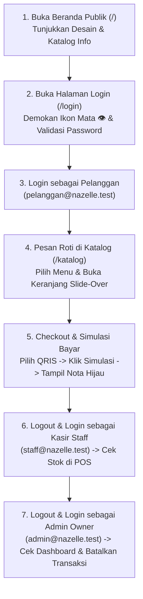
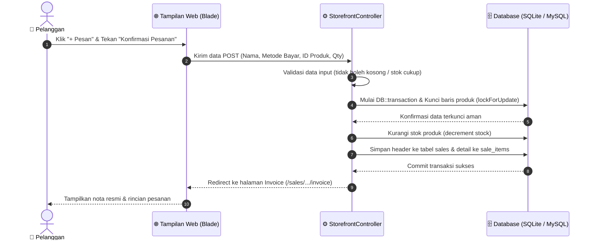

# Panduan Lengkap Presentasi Project Website Nazelle Délices
**Mata Kuliah: Pemrograman Web 2 (Ujian Tengah Semester - Laravel Framework)**  
*Disusun khusus untuk mahasiswa pemula dengan gaya bahasa yang sederhana, jelas, dan mudah dipahami.*

---

## 📑 DAFTAR ISI PANDUAN
1. [Pengenalan Project & Skenario Bisnis](#1-pengenalan-project--skenario-bisnis)
2. [Penjelasan Seluruh Halaman Website](#2-penjelasan-seluruh-halaman-website)
3. [Tutorial Skenario Demonstrasi di Depan Dosen](#3-tutorial-skenario-demonstrasi-di-depan-dosen)
4. [Peta Struktur Folder Project di VS Code](#4-peta-struktur-folder-project-di-vs-code)
5. [Bedah Kode Kunci (Line-by-Line Code Walkthrough)](#5-bedah-kode-kunci-line-by-line-code-walkthrough)
6. [Arsitektur & Siklus Data Database](#6-arsitektur--siklus-data-database)
7. [Panduan Menjalankan Project di VS Code & Troubleshooting](#7-panduan-menjalankan-project-di-vs-code--troubleshooting)
8. [Naskah Lengkap Presentasi (Dari Pembukaan s.d. Penutup)](#8-naskah-lengkap-presentasi-dari-pembukaan-sd-penutup)
9. [Prediksi 12 Pertanyaan Dosen & Jawaban Mantap](#9-prediksi-12-pertanyaan-dosen--jawaban-mantap)
10. [Checklist Final Sebelum Maju Presentasi](#10-checklist-final-sebelum-maju-presentasi)

---

# 1. Pengenalan Project & Skenario Bisnis

### A. Apa itu Website Nazelle Délices?
**Nazelle Délices** adalah aplikasi web manajemen dan toko online untuk sebuah butik toko roti dan kue (*pastry & bakery*) bergaya tradisional Prancis (*French Pâtisserie & Boulangerie*) yang berlokasi di Senopati, Jakarta Selatan. 

Aplikasi ini tidak hanya menampilkan katalog kue yang cantik kepada pelanggan, tetapi juga memiliki sistem operasional kasir (*Point of Sale / POS*), pencatatan restock bahan baku dari supplier, dan dashboard analitik keuangan untuk pemilik toko.

> **💡 Analogi Sederhana:**  
> Bayangkan Nazelle Délices seperti sebuah restoran kue fisik:
> * Bagian etalase depan (*front-of-house*) tempat pembeli melihat roti croissant hangat dan memesan.
> * Meja kasir tempat staf kasir melayani transaksi cepat dan mencetak struk.
> * Dapur dan gudang belakang (*back-of-house*) tempat baker mencatat tepung dan mentega yang baru datang dari supplier.
> * Ruang kantor pemilik (*back-office*) tempat bos melihat laporan berapa roti yang terjual dan keuntungan hari ini.  
> Semua aktivitas tersebut digabungkan ke dalam satu sistem web yang terintegrasi.

---

### B. Tujuan Pembuatan Website
1. **Mempermudah Pelanggan**: Pelanggan dapat melihat menu roti artisan segar dari rumah/ponsel, mengetahui sisa stok secara real-time, memesan langsung, memilih metode pembayaran (QRIS, Transfer Bank, Bayar di Kasir), dan mencetak nota pesanan.
2. **Mempercepat Pelayanan Kasir**: Staf toko dapat mencatat penjualan kasir (POS) hanya dengan mengklik gambar menu tanpa perlu menghitung total belanja atau kembalian uang secara manual.
3. **Mengotomatisasi Stok & Mengurangi Kerugian**: Setiap ada pesanan yang berhasil, stok roti di gudang langsung berkurang otomatis. Pemilik toko tahu varian roti mana yang stoknya menipis (*Baker's Alert*).

---

### C. Masalah Nyata yang Diselesaikan Sistem
| Masalah di Toko Tradisional | Solusi yang Dibuat di Project Nazelle Délices |
| :--- | :--- |
| **Overselling (Stok Habis tapi Tetap Terjual)**: Pembeli memesan 5 croissant, padahal sisa stok tinggal 2. | **Pessimistic Locking & Pengecekan Server**: Sistem mengunci data stok saat transaksi terjadi (`lockForUpdate`). Jika sisa stok tidak cukup, sistem langsung menolak dan membatalkan pesanan. |
| **Kecurangan Perubahan Harga (Client-side Hack)**: Pembeli nakal mengubah harga kue Rp 28.000 menjadi Rp 1.000 lewat Inspect Element browser. | **Zero-Trust Client Input**: Total belanja tidak dihitung dari JavaScript di browser, melainkan dihitung ulang 100% di server berdasarkan harga resmi yang tersimpan di database. |
| **Data Nyangkut saat Error (Inkonsistensi Data)**: Uang sudah tercatat masuk, tapi karena koneksi putus, data stok gagal berkurang. | **Atomic Database Transaction (`DB::transaction`)**: Menganut prinsip *All-or-Nothing*. Jika ada satu item yang bermasalah, seluruh transaksi dibatalkan kembali ke kondisi semula (*rollback*). |
| **Kebocoran Hak Akses**: Pembeli biasa mencoba membuka halaman rahasia Admin dengan mengetik URL `/users` atau `/dashboard`. | **Server-side Middleware (`EnsureAdmin`)**: Server memeriksa role akun. Jika bukan Admin, request langsung diputus dengan pesan error `403 Forbidden`. |

---

### D. Siapa Saja Penggunanya? (3 Role Pengguna)
Website ini membagi hak akses ke dalam **3 peran pengguna** yang memiliki tampilan dan batasan berbeda:

1. 👑 **Owner / Administrator (`role: admin`)**:
   * Memiliki kekuasaan tertinggi di dalam sistem.
   * Mengelola master data: menambah produk kue baru, mengedit harga, menambah kategori, dan mengelola supplier bahan baku.
   * Mengatur akun pengguna: dapat menambah staf baru atau melihat daftar pelanggan.
   * Membatalkan transaksi penjualan yang salah dan sistem otomatis mengembalikan stok kue ke rak (*restore stock*).
   * Memantau ringkasan omzet harian, bulanan, dan produk terlaris di Dashboard.

2. 🥖 **Staff Kasir & Baker (`role: staff`)**:
   * Bertugas melayani kasir POS penjualan langsung kepada pengunjung yang datang ke butik.
   * Mencatat pembelian restock bahan baku masuk (*stock-in*) dari supplier (misalnya tepung T55, mentega Prancis Elle & Vire).
   * Melihat status stok barang yang menipis.
   * **Dibatasi**: Tidak bisa menghapus akun user, tidak bisa mengubah data master toko.

3. 🧁 **Pelanggan (`role: customer`)**:
   * Pengguna umum atau pembeli yang mendaftar melalui halaman registrasi.
   * Menjelajahi katalog etalase kue, memfilter kategori, dan mencari produk (*live search*).
   * Memasukkan kue ke keranjang belanja interaktif (*slide-over cart*).
   * Melakukan checkout pesanan dengan pilihan metode pembayaran (QRIS, Transfer Bank, Kasir).
   * Melakukan simulasi pembayaran agar transaksi terverifikasi.
   * Melihat riwayat nota pesanan (*Pesanan Saya*) dan mencetak struk belanja.

---

### E. Teknologi yang Digunakan & Fungsinya
* **PHP 8.1 / 8.2**: Bahasa pemrograman backend utama yang memproses seluruh logika di server.
* **Laravel Framework**: Kerangka kerja (*framework*) PHP modern yang menyediakan fitur routing, sistem keamanan, otentikasi, dan manipulasi database dengan standar industri.
* **Blade Templating Engine**: Mesin pembuat tampilan HTML bawaan Laravel. Memudahkan pembuatan template halaman yang rapi menggunakan komponen `@extends`, `@section`, `@if`, dan `@auth`.
* **Tailwind CSS & FontAwesome**: Mengatur desain antarmuka, tata letak kartu produk, tipografi anggun khas butik Prancis (*Cormorant Garamond*), serta ikon-ikon visual seperti ikon mata 👁️ pada password dan ikon troli belanja.
* **SQLite / MySQL**: Tempat penyimpanan data permanen (*database*). SQLite digunakan untuk pengujian cepat mandiri tanpa setup, dan MySQL didukung penuh untuk server XAMPP.
* **Composer**: Alat manajemen paket dependensi PHP (seperti pustaka enkripsi kata sandi dan manipulasi tanggal Carbon).

---

# 2. Penjelasan Seluruh Halaman Website

Berikut adalah panduan detail setiap halaman yang ada di project Nazelle Délices:

---

### 1. Halaman Beranda / Landing Page (`/` atau `/beranda`)
* **Fungsi**: Pintu masuk utama bagi siapa saja yang membuka website tanpa perlu login terlebih dahulu. Bertujuan mengenalkan brand, reputasi bahan baku artisan Prancis, dan etalase kue unggulan.
* **Komponen yang Terlihat**:
  1. **Top Navbar**: Logo croissant Nazelle Délices, menu navigasi (*Beranda, Tentang Kami, Produk Unggulan, Keunggulan, Menu & Katalog*), serta tombol permanen **Masuk** dan **Daftar**. Jika pengguna sudah login, tombol **Dashboard** juga akan tampil.
  2. **Hero Section**: Tagline *"A Little Taste of Elegance"*, judul besar *"Sentuhan Elegan di Setiap Gigitan Pastry Prancis"*, deskripsi toko, tombol aksi *"Buka Menu & Pesan Sekarang"*, *"Masuk ke Akun"*, dan *"Daftar Pelanggan"*.
  3. **Trust Badges**: Penjelasan 3 pilar kualitas (100% Mentega Prancis AOP, Fermentasi Alami 24-36 Jam, Dipanggang Segar Setiap Fajar).
  4. **Katalog Produk Unggulan**: Menampilkan 6 kreasi pastry terbaik dari database lengkap dengan foto, lencana kategori, lencana sisa stok, nama pastry, deskripsi rasa, dan harga.  
     *(Catatan jujur: Kartu produk di beranda murni bersifat informatif tanpa tombol beli instan, karena pembelian online difokuskan setelah pelanggan login).*
  5. **Keunggulan Toko & Kontak Butik**: Informasi alamat butik di Jl. Patisserie No. 42 Senopati Jakarta Selatan, jam operasional (07:00 - 21:00 WIB), nomor telepon, dan Instagram.
* **Cara Demonstrasi ke Dosen**:
  > *"Bapak/Ibu Dosen, ini adalah Landing Page utama Nazelle Délices. Siapa pun pengunjung dapat melihat identitas butik dan katalog produk tanpa wajib login. Tombol Masuk dan Daftar sengaja kami tempatkan secara permanen di navbar dan hero section agar pengunjung mudah melakukan autentikasi."*

---

### 2. Halaman Masuk / Login (`/login`)
* **Fungsi**: Tempat pengguna memasukkan kredensial (email atau nama pengguna beserta password) untuk masuk ke sistem sesuai perannya.
* **Komponen yang Terlihat**:
  1. **Formulir Input**: Kolom input *Email / Username* dan kolom input *Kata Sandi*.
  2. **Ikon Mata Intip Password (👁️)**: Tombol interaktif di dalam kolom kata sandi. Jika diklik, karakter password yang semula tertutup bintang/bulatan (`type="password"`) akan terlihat jelas (`type="text"`), dan ikon berubah menjadi mata dicoret.
  3. **Tombol "Masuk ke Akun"**: Mengirimkan data formulir ke controller untuk divalidasi ke database.
  4. **Kartu Keterangan Akun Uji Coba**: Kotak panduan elegan yang mencantumkan email dan password akun demo (Admin, Staff, Pelanggan) untuk kemudahan penilaian.
* **Alur Validasi**:
  * Tidak ada tombol jalan pintas (*no bypass login*). Pengguna wajib menekan tombol "Masuk ke Akun".
  * Jika password salah, halaman akan menampilkan peringatan merah: *"Email atau kata sandi salah"*.
  * Jika benar, pengguna diarahkan ke dashboard sesuai perannya.
* **Cara Demonstrasi ke Dosen**:
  > *"Pada halaman login ini, kami menerapkan autentikasi murni berbasis database menggunakan algoritma enkripsi Bcrypt. Kami juga menambahkan fitur tombol mata 👁️ untuk mempermudah pengguna memastikan kata sandi yang mereka ketik sudah benar sebelum menekan tombol masuk."*

---

### 3. Halaman Pendaftaran Akun Pelanggan (`/register`)
* **Fungsi**: Memfasilitasi pengunjung umum untuk membuat akun baru sebagai **Pelanggan**.
* **Komponen yang Terlihat**: Formulir Nama Lengkap, Alamat Email, Kata Sandi, Konfirmasi Kata Sandi, dan tombol *"Daftar Akun Pelanggan"*.
* **Aturan Keamanan**:
  * Pendaftaran publik otomatis menetapkan `role: customer`.
  * Tidak ada pilihan memilih role Admin/Staff di form ini demi mencegah orang asing membajak akses pengelola toko.
  * Validasi mewajibkan email bersifat unik (tidak boleh kembar di database) dan konfirmasi kata sandi harus cocok.
* **Cara Demonstrasi ke Dosen**:
  > *"Formulir registrasi ini menerapkan validasi ganda di server: memeriksa apakah email sudah pernah dipakai atau belum, serta mengunci hak akses agar pengguna baru hanya bisa terdaftar sebagai Pelanggan."*

---

### 4. Halaman Etalase Katalog & Pemesanan (`/katalog` atau `/menu`)
* **Fungsi**: Tempat pelanggan menjelajahi menu pastry, menyaring kategori, mencari kue favorit, dan memasukkan produk ke keranjang belanja.
* **Komponen yang Terlihat**:
  1. **Filter Kategori (Pills Bar)**: Tombol pilihan kategori (*Viennoiserie, Artisan Sourdough, Patisserie & Tarts, Cakes, Savory, Coffee*).
  2. **Pencarian Cepat (*Search Bar*)**: Pelanggan bisa mengetik nama produk (misalnya: "Croissant") dan menekan Enter.
  3. **Kartu Menu Pastry**: Foto produk, SKU, nama, deskripsi, harga, indikator stok (*Tersedia XX pcs*, *Sisa X pcs*, atau *Habis*), serta tombol kuning **"+ Pesan"**.
  4. **Tombol Keranjang Mengambang (*Floating Cart Button*)**: Menampilkan jumlah kue yang ada di troli belanja beserta total harga sementara.
  5. **Panel Keranjang Geser (*Slide-over Cart Drawer*)**: Panel interaktif yang muncul dari sisi kanan layar saat tombol troli ditekan.
* **Komponen di Dalam Keranjang Belanja**:
  * Daftar kue yang dipilih dengan tombol plus (+) dan minus (-) untuk menambah atau mengurangi jumlah.
  * Input Nama Pemesan.
  * Input Catatan Khusus (misal: "Tolong dihangatkan", "Dipisah plastiknya").
  * **Pilihan 3 Metode Pembayaran**:
    1. **QRIS** (Pembayaran scan kode digital)
    2. **Transfer Bank** (Rekening BCA / Mandiri butik)
    3. **Bayar di Kasir** (Tunai di tempat)
  * Tombol hijau: **"Konfirmasi & Buat Pesanan"**.
* **Cara Demonstrasi ke Dosen**:
  > *"Di halaman katalog ini, pelanggan dapat mengklik '+ Pesan' pada menu favoritnya. Keranjang slide-over di sebelah kanan akan menghitung subtotal secara langsung. Pelanggan cukup memilih metode pembayaran seperti QRIS atau Transfer Bank lalu menekan tombol Konfirmasi Pesanan."*

---

### 5. Halaman Faktur / Nota Pesanan & Simulasi Pembayaran (`/sales/{sale}/invoice`)
* **Fungsi**: Menampilkan bukti pemesanan resmi yang siap dicetak (*thermal / printable receipt*), memuat nomor pesanan unik, rincian biaya, status pembayaran, dan fitur simulasi bayar.
* **Komponen yang Terlihat**:
  1. **Kop Toko Roti**: Logo Nazelle Délices, alamat butik Senopati, nomor telepon, dan tagline.
  2. **Informasi Transaksi**: Nomor Nota (contoh: `INV-20261027-0001`), tanggal/jam pemesanan, nama pelanggan, dan metode pembayaran yang dipilih.
  3. **Tabel Rincian**: Nama pastry, kuantitas, harga satuan, dan subtotal.
  4. **Lencana Status Pembayaran**:
     * Merah / Amber: *"Menunggu Pembayaran"* jika belum dibayar.
     * Hijau Bersinar: *"Pembayaran Berhasil"* jika sudah diverifikasi.
  5. **Tombol "Simulasi Pembayaran (Uji Coba UTS)"**:
     * Khusus disediakan untuk keperluan penilaian akademik agar penguji/dosen dapat menguji perubahan status transaksi dari *Unpaid* menjadi *Paid* tanpa harus menghubungkan rekening bank sungguhan.
     * Saat diklik, sistem mengisi kolom `paid_at` dengan jam sekarang dan membuat kode referensi unik `SIM-XXXX`.
     * Menampilkan label resmi *"Simulasi Pembayaran (Keperluan Pengujian Kuliah)"*.
  6. **Tombol "Cetak Bukti Nota (PDF/Print)"**: Membuka dialog print browser untuk mencetak nota belanja.

---

### 6. Halaman Kasir POS Toko Roti (`/sales/create`)
* **Fungsi**: Khusus digunakan oleh **Staff Kasir** untuk melayani pembeli langsung di kasir butik dengan tempo cepat.
* **Komponen yang Terlihat**:
  * Grid kartu menu pastry yang dapat diklik satu kali untuk langsung masuk ke daftar struk kasir.
  * Kolom pengisian uang tunai yang diterima dari pembeli (*Cash Input*).
  * Kalkulator kembalian otomatis (*Change Calculator*): Menghitung otomatis uang kembalian agar kasir tidak salah hitung.
  * Tombol *"Selesaikan Pembayaran & Cetak Struk"*.

---

### 7. Halaman Pengadaan Bahan Baku / Restock (`/purchases/create`)
* **Fungsi**: Digunakan oleh **Staff** atau **Admin** untuk mencatat pasokan bahan baku atau roti yang baru selesai dipanggang oleh Baker dari supplier.
* **Komponen yang Terlihat**:
  * Pilihan Supplier (misal: PT Bogasari Flour, Elle & Vire Dairy Normandy).
  * Tabel multi-item dinamis untuk memilih nama bahan/produk, kuantitas masuk, dan harga beli per unit.
  * Saat tombol disimpan, stok produk di database otomatis bertambah (*increment*).

---

### 8. Halaman Dashboard Pengguna (`/dashboard`)
* Tampilan dashboard otomatis menyesuaikan role yang sedang login:
  * **Jika Admin / Owner**: Menampilkan kartu statistik total produk, omzet hari ini, omzet bulan ini, daftar kue yang stoknya kritis (*Baker's Alert*), dan link cepat ke manajemen master produk, kategori, supplier, serta pembatalan transaksi.
  * **Jika Staff**: Menampilkan ringkasan transaksi kasir hari ini, daftar kue yang perlu dipanggang ulang, dan tombol cepat ke POS Kasir.
  * **Jika Pelanggan**: Menampilkan sapaan hangat Prancis (*"Bonjour, Sophie!"*), jumlah pesanan yang sedang diproses, dan tombol untuk melihat riwayat nota pesanan (*Pesanan Saya*).

---

# 3. Tutorial Skenario Demonstrasi di Depan Dosen

Agar presentasi Anda berjalan mulus dan meyakinkan di depan dosen penguji, ikuti urutan langkah demonstrasi berikut ini:



### Tahap 1: Memperkenalkan Beranda Publik (Tanpa Login)
1. Buka browser di alamat: `http://127.0.0.1:8000/`.
2. Jelaskan kepada dosen bahwa halaman ini adalah Landing Page butik Nazelle Délices.
3. Sorot bagian kartu kreasi produk: tunjukkan bahwa produk menampilkan foto, deskripsi, harga, dan sisa stok. Jelaskan bahwa pemesanan online dilakukan setelah pelanggan masuk ke akunnya.
4. Tunjukkan tombol **"Masuk"** dan **"Daftar"** yang selalu terlihat di pojok kanan atas dan di hero section.

---

### Tahap 2: Menunjukkan Form Login & Fitur Ikon Mata 👁️
1. Klik tombol **"Masuk"** untuk menuju halaman `/login`.
2. **Uji Coba Password Salah**:
   * Ketik email: `pelanggan@nazelle.test`.
   * Ketik password asal: `salah123`.
   * Klik tombol **ikon mata (👁️)**: tunjukkan bahwa teks sandi yang tadinya tersembunyi kini terlihat.
   * Tekan tombol **"Masuk ke Akun"**.
   * Tunjukkan pesan error merah dari server: *"Email atau kata sandi salah"*.
   * *Penjelasan ke dosen*: *"Bapak/Ibu, sistem ini memverifikasi kata sandi secara ketat menggunakan fungsi Hash::check ke database dan tidak memiliki celah bypass."*

---

### Tahap 3: Pemesanan oleh Pelanggan & Simulasi Pembayaran
1. Ketik password yang benar: `password` lalu tekan **Masuk ke Akun**.
2. Anda akan disambut di halaman dashboard pelanggan.
3. Klik menu **"Menu & Toko"** di navbar atas (`/katalog`).
4. Klik tombol kuning **"+ Pesan"** pada 2 produk yang berbeda (misalnya: *Croissant au Beurre* 2 pcs dan *Artisan French Baguette* 1 pcs).
5. Klik tombol keranjang di pojok kanan bawah. Panel keranjang (*slide-over*) akan terbuka.
6. Masukkan nama pemesan (misal: "Budi Santoso").
7. Pada pilihan metode pembayaran, pilih **QRIS**.
8. Klik tombol **"Konfirmasi & Buat Pesanan"**.
9. Sistem akan mengarahkan ke halaman Faktur Nota (`/sales/.../invoice`).
10. Tunjukkan status pesanan: awalnya berstatus *"Menunggu Pembayaran"*.
11. Klik tombol **"Simulasi Pembayaran (Uji Coba UTS)"**.
12. Halaman akan memuat ulang dan lencana berubah menjadi hijau: **"Pembayaran Berhasil"** dengan kode referensi unik dan tanggal/jam pembayaran tercatat resmi di database.
13. Klik tombol **"Cetak Bukti Nota"** untuk memperlihatkan layout print nota yang bersih dan rapi.

---

### Tahap 4: Verifikasi di Sisi Staff Kasir & Pengurangan Stok
1. Klik tombol **Logout** (ikon pintu keluar di pojok kanan atas).
2. Login menggunakan akun Staff:
   * Email: `staff@nazelle.test`
   * Password: `password`
3. Masuk ke menu **"Kasir (POS)"** di navbar atas (`/sales/create`).
4. Tunjukkan kepada dosen bahwa sisa stok croissant yang tadi dibeli oleh Budi Santoso **sudah otomatis berkurang** secara real-time di sistem kasir.
5. Lakukan uji coba kasir cepat: klik satu menu roti, masukkan nominal uang tunai pembeli di kolom bayar, dan tunjukkan bahwa kalkulator kembalian otomatis menghitung uang kembalian pembeli.

---

### Tahap 5: Manajemen Eksekutif di Sisi Admin / Owner
1. Logout kembali, lalu login sebagai Admin / Owner:
   * Email: `admin@nazelle.test`
   * Password: `password`
2. Tunjukkan **Dashboard Admin**:
   * Total omzet pendapatan hari ini dan grafik penjualan telah bertambah secara otomatis sesuai transaksi tadi.
   * Tabel stok menipis (*Baker's Alert*) memberikan sinyal kepada bagian dapur untuk memproduksi roti baru.
3. Masuk ke menu **"Penjualan"** (`/sales`), klik nota pesanan yang tadi dibuat.
4. Klik tombol merah **"Batalkan Transaksi"**:
   * Jelaskan ke dosen: *"Jika pelanggan membatalkan pesanan, Admin dapat menekan tombol ini. Sistem akan menjalankan DB::transaction untuk menandai nota sebagai Cancelled sekaligus mengembalikan (restore) stok produk ke rak secara otomatis."*

---

# 4. Peta Struktur Folder Project di VS Code

Saat Anda membuka folder `Nazelle-Delices` di VS Code, Anda akan melihat struktur folder standar Laravel yang rapi. Berikut adalah peta fungsi setiap folder dan file:

```
Nazelle-Delices/
├── app/                  # [Otak Aplikasi] Logika bisnis, Controller, Model database, dan Middleware
│   ├── Http/
│   │   ├── Controllers/  # Juru masak logika: Mengambil request, memproses data, memanggil view
│   │   └── Middleware/   # Satpam penjaga: Memeriksa hak akses role sebelum halaman dibuka
│   └── Models/           # Perwakilan tabel database dalam bentuk class PHP (Eloquent)
├── bootstrap/            # Berkas booting dan cache internal Laravel
├── config/               # Berkas konfigurasi aplikasi, koneksi database, session, dll.
├── database/             # [Penyimpanan Data]
│   ├── migrations/       # Cetak biru rancangan struktur tabel database
│   ├── seeders/          # Berkas pengisi data awal otomatis (produk, akun admin, dll.)
│   └── database.sqlite   # File database lokal SQLite yang menyimpan seluruh data aktif
├── public/               # [Pintu Luar] Berkas yang dapat diakses browser (index.php, CSS, favicon)
├── resources/            # [Tampilan Antarmuka]
│   └── views/            # Seluruh file HTML/Blade template (auth, landing, sales, storefront)
├── routes/               # [Resepsionis / Peta Jalan]
│   └── web.php           # Daftar URL website dan pengarahannya ke Controller
├── storage/              # Tempat penyimpanan file cache, log error, dan file unggahan
├── tests/                # Berkas pengujian otomatis (24 test skenario fitur)
├── vendor/               # Seluruh kumpulan pustaka dan library PHP yang diunduh Composer
├── .env                  # Catatan konfigurasi lokal komputer saat ini (Koneksi DB, App Key)
├── .env.example          # Contoh template konfigurasi aman untuk dibagikan di GitHub
├── .gitignore            # Daftar berkas rahasia/besar yang dilarang di-upload ke GitHub
├── artisan               # Program CLI Laravel untuk menjalankan perintah terminal (php artisan ...)
├── composer.json         # Daftar nama dan versi pustaka PHP yang dibutuhkan project
└── jalankan.bat          # Script otomatis 1-klik untuk menyalakan server di laptop Windows
```

---

# 5. Bedah Kode Kunci (Line-by-Line Code Walkthrough)

Dosen sangat suka menunjuk file kode tertentu dan bertanya: *"Bagaimana potongan kode ini bekerja?"*.  
Berikut adalah 6 file paling krusial di project ini beserta cara menjelaskannya:

---

### File 1: Resepsionis Web — `routes/web.php`
* **Lokasi File**: `routes/web.php`
* **Kegunaan**: Mendaftarkan semua alamat URL yang bisa dibuka di browser dan menentukan controller mana yang bertugas memprosesnya.

```php
// 1. Route Publik (Bisa diakses siapa saja tanpa login)
Route::get('/', [LandingController::class, 'index'])->name('landing');
Route::get('/katalog', [StorefrontController::class, 'index'])->name('storefront.index');

// 2. Route Autentikasi Tamu (Hanya untuk yang belum login)
Route::middleware('guest')->group(function () {
    Route::get('/login', [AuthController::class, 'showLoginForm'])->name('login');
    Route::post('/login', [AuthController::class, 'login']);
    Route::get('/register', [AuthController::class, 'showRegisterForm'])->name('register');
    Route::post('/register', [AuthController::class, 'register']);
});

// 3. Route Khusus Admin (Dipagari Middleware auth dan admin)
Route::middleware(['auth', 'admin'])->group(function () {
    Route::resource('users', UserController::class);
    Route::post('sales/{sale}/cancel', [SaleController::class, 'cancel'])->name('sales.cancel');
});
```
* **Penjelasan Sederhana per Bagian**:
  * Baris 1: Jika pengunjung membuka URL utama `/`, Laravel memanggil fungsi `index()` di `LandingController`.
  * Baris 5-10: Middleware `guest` memastikan jika seseorang sudah login, mereka tidak akan bisa membuka halaman `/login` lagi melainkan langsung dilempar ke dashboard.
  * Baris 13-16: Middleware `['auth', 'admin']` adalah gerbang pengaman ganda: pengguna wajib login (`auth`) DAN memiliki role Admin (`admin`). Jika pelanggan biasa mencoba mengakses `/users`, server otomatis menolak.
* **Cara Menjelaskan ke Dosen**:
  > *"File `routes/web.php` ini adalah peta navigasi aplikasi kami. Kami membagi rute menjadi tiga kelompok: rute publik untuk beranda dan katalog, rute tamu untuk login dan register, serta rute terproteksi yang diamankan middleware untuk mencegah pembeli membuka fungsi manajemen Admin."*

---

### File 2: Keamanan Login Murni — `app/Http/Controllers/AuthController.php`
* **Lokasi File**: `app/Http/Controllers/AuthController.php`
* **Kegunaan**: Menangani proses verifikasi email/username dan kata sandi saat pengguna masuk ke akun.

```php
public function login(Request $request): RedirectResponse
{
    // Langkah 1: Validasi input tidak boleh kosong
    $request->validate([
        'email' => ['required', 'string'],
        'password' => ['required', 'string'],
    ]);

    $loginInput = trim($request->input('email'));
    $password = $request->input('password');

    // Langkah 2: Cari pengguna berdasarkan email ATAU nama di database
    $user = User::where('email', $loginInput)
        ->orWhere('name', $loginInput)
        ->first();

    // Langkah 3: Verifikasi keamanan kata sandi dengan Hash::check
    if (! $user || ! Hash::check($password, $user->password)) {
        return back()->withErrors([
            'email' => 'Email atau kata sandi salah',
        ])->onlyInput('email');
    }

    // Langkah 4: Berhasil! Buat sesi login baru
    Auth::login($user, $request->boolean('remember'));
    $request->session()->regenerate();

    return redirect()->intended(route('dashboard'))
        ->with('success', "Selamat datang, {$user->name}!");
}
```
* **Penjelasan Sederhana per Baris**:
  * `Hash::check($password, $user->password)`: Ini adalah bagian terpenting. Password di database tersimpan dalam bentuk acak/terenkripsi (misal: `$2y$10$...`). Fungsi ini memeriksa apakah password yang diketik pembeli cocok dengan enkripsi di database tanpa pernah mendekripsinya.
  * `session()->regenerate()`: Mencegah serangan *Session Fixation* dengan cara memperbarui ID sesi browser setelah user berhasil login.
* **Cara Menjelaskan ke Dosen**:
  > *"Pada fungsi login ini, kami menerapkan prinsip zero-trust. Kami tidak menggunakan mekanisme bypass. Password diverifikasi menggunakan `Hash::check` yang membandingkan teks polos dengan hash Bcrypt di database. Jika tidak cocok, pesan error generik ditampilkan untuk mencegah penyerang menebak apakah emailnya terdaftar atau tidak."*

---

### File 3: Jantung Transaksi & Anti-Overselling — `app/Http/Controllers/StorefrontController.php`
* **Lokasi File**: `app/Http/Controllers/StorefrontController.php` (fungsi `checkout`)
* **Kegunaan**: Memproses pesanan dari keranjang belanja, memotong stok roti secara aman, dan mencatat transaksi penjualan.

```php
$sale = DB::transaction(function () use ($validated, $request) {
    // 1. Buat record transaksi penjualan baru
    $sale = Sale::create([
        'user_id'        => Auth::id() ?? 1,
        'sale_number'    => $this->generateSaleNumber(),
        'customer_name'  => $validated['customer_name'],
        'payment_method' => $validated['payment_method'] ?? 'cashier',
        'payment_status' => 'unpaid',
        'status'         => 'completed',
        'sold_at'        => Carbon::now(),
    ]);

    $grandTotal = 0;

    foreach ($validated['items'] as $itemData) {
        // 2. Kunci baris database agar tidak dibeli orang lain di saat yang sama
        $product = Product::lockForUpdate()->findOrFail($itemData['product_id']);
        $qty = (int) $itemData['quantity'];

        // 3. Pengecekan sisa stok
        if ($qty < 1 || $product->stock < $qty) {
            throw ValidationException::withMessages([
                'items' => "Mohon maaf, stok '{$product->name}' tidak mencukupi. Sisa: {$product->stock} pcs."
            ]);
        }

        // 4. Hitung harga resmi langsung dari database
        $unitPrice = (float) $product->selling_price;
        $subtotal = $unitPrice * $qty;

        $sale->items()->create([
            'product_id' => $product->id,
            'quantity'   => $qty,
            'unit_price' => $unitPrice,
            'subtotal'   => $subtotal,
        ]);

        // 5. Potong stok produk secara atomik
        $product->decrement('stock', $qty);
        $grandTotal += $subtotal;
    }

    $sale->update(['total' => $grandTotal]);
    return $sale;
});
```
* **Penjelasan Konsep Tingkat Tinggi**:
  1. `DB::transaction(...)`: Membungkus semua operasi ke dalam satu paket atomik. Jika produk pertama sukses dipotong stoknya, tetapi produk kedua ternyata kehabisan stok, seluruh pesanan otomatis dibatalkan (*rollback*) dan stok produk pertama dikembalikan seketika.
  2. `lockForUpdate()`: Menerapkan *Pessimistic Locking*. Jika dua pembeli menekan tombol beli pada detik yang sama untuk sisa 1 croissant terakhir, pembeli pertama akan dilayani, sementara pembeli kedua harus menunggu hingga transaksi pembeli pertama selesai. Ini mencegah sisa stok menjadi minus (-1).
  3. `$product->selling_price`: Harga barang diambil langsung dari database server, bukan dari input formulir browser.
* **Cara Menjelaskan ke Dosen**:
  > *"Ini adalah fungsi paling krusial di project kami, yaitu method `checkout()`. Kami mengamankannya dengan dua pilar utama: pertama, `DB::transaction` untuk menjamin konsistensi ACID, dan kedua, `Product::lockForUpdate()` untuk mencegah race-condition dan overselling stok saat website ramai diakses."*

---

### File 4: Simulasi Pembayaran — `app/Http/Controllers/SaleController.php`
* **Lokasi File**: `app/Http/Controllers/SaleController.php` (fungsi `simulatePayment`)
* **Kegunaan**: Mengubah status pesanan menjadi lunas untuk pengujian presentasi.

```php
public function simulatePayment(Sale $sale): RedirectResponse
{
    if ($sale->status === 'cancelled') {
        return back()->with('error', 'Pesanan yang telah dibatalkan tidak dapat diproses simulasinya.');
    }

    $sale->update([
        'payment_status' => 'paid',
        'paid_at'        => now(),
        'payment_ref'    => 'SIM-' . strtoupper(bin2hex(random_bytes(4))),
    ]);

    return redirect()->route('sales.invoice', $sale)
        ->with('success', 'Simulasi pembayaran berhasil! Transaksi kini berstatus Pembayaran Berhasil.');
}
```
* **Penjelasan Baris**:
  * Baris 8: Menghasilkan kode referensi simulasi pembayaran acak (contoh: `SIM-A8F2C1D4`).
  * Baris 7: Mencatat tanggal dan jam pembayaran saat tombol ditekan (`paid_at`).
* **Cara Menjelaskan ke Dosen**:
  > *"Fitur `simulatePayment` ini kami buat khusus untuk kebutuhan demonstrasi akademik. Saat tombol simulasi diklik, sistem memperbarui status transaksi menjadi 'paid' di database, menyimpan stempel waktu pelunasan, dan menerbitkan nomor referensi pembayaran sehingga nota langsung berstatus lunas."*

---

### File 5: Satpam Pengaman Admin — `app/Http/Middleware/EnsureAdmin.php`
* **Lokasi File**: `app/Http/Middleware/EnsureAdmin.php`
* **Kegunaan**: Menolak pengunjung yang bukan Admin agar tidak bisa membuka menu manajemen user atau pembatalan transaksi.

```php
public function handle(Request $request, Closure $next): Response
{
    if (! $request->user() || ! $request->user()->isAdmin()) {
        abort(403, 'Akses Ditolak: Fitur ini hanya dapat diakses oleh Admin / Owner.');
    }

    return $next($request);
}
```
* **Cara Menjelaskan ke Dosen**:
  > *"Middleware `EnsureAdmin` ini bertindak sebagai penjaga gerbang server. Jika ada pengguna yang mencoba mengetik URL admin secara langsung, fungsi `$request->user()->isAdmin()` akan menguji apakah role akun adalah 'admin'. Jika bukan, server langsung menghentikan request dan merespons dengan HTTP Status 403 Forbidden."*

---

### File 6: JavaScript Ikon Mata — `resources/views/auth/login.blade.php`
* **Lokasi File**: `resources/views/auth/login.blade.php`
* **Kegunaan**: Mengubah tipe input password dari tersembunyi menjadi terlihat saat ikon mata diklik.

```javascript
function togglePasswordVisibility() {
    const passwordInput = document.getElementById('password');
    const eyeIcon = document.getElementById('eyeIcon');
    
    if (passwordInput.type === 'password') {
        passwordInput.type = 'text';
        eyeIcon.classList.remove('fa-eye');
        eyeIcon.classList.add('fa-eye-slash');
    } else {
        passwordInput.type = 'password';
        eyeIcon.classList.remove('fa-eye-slash');
        eyeIcon.classList.add('fa-eye');
    }
}
```
* **Cara Menjelaskan ke Dosen**:
  > *"Pada halaman login, kami menambahkan script JavaScript sederhana pada elemen input password. Saat ikon mata diklik, atribut `type` pada input password berganti antara 'password' dan 'text', serta kelas FontAwesome berganti dari `fa-eye` menjadi `fa-eye-slash` untuk memberikan feedback visual kepada pengguna."*

---

# 6. Arsitektur & Siklus Data Database

### A. Tabel-Tabel di Dalam Database
Database Nazelle Délices memiliki 8 tabel utama yang saling terhubung:
1. **`users`**: Menyimpan akun pengguna (nama, email, password terenkripsi, dan role: `admin`, `staff`, atau `customer`).
2. **`categories`**: Menyimpan kategori menu (*Viennoiserie*, *Sourdough*, *Patisserie*, dll.).
3. **`products`**: Menyimpan data produk kue (SKU unik, nama, deskripsi rasa, URL foto, harga beli, harga jual, jumlah stok, dan batas minimum stok).
4. **`suppliers`**: Menyimpan data pemasok bahan baku (nama distributor, telepon, alamat).
5. **`purchases`**: Menyimpan nota pembelian restock bahan baku dari supplier.
6. **`purchase_items`**: Menyimpan rincian bahan/produk yang dibeli pada nota pembelian.
7. **`sales`**: Menyimpan nota penjualan kepada pembeli (nomor nota unik, nama pelanggan, total biaya, metode pembayaran, status pembayaran, jam bayar).
8. **`sale_items`**: Menyimpan rincian kue apa saja yang dibeli pada nota penjualan beserta jumlah dan harga satuannya.

---

### B. Hubungan Antartabel (Relasi Eloquent)
* **Kategori ke Produk (One-to-Many)**: Satu Kategori memiliki banyak Produk. Satu Produk pasti tergolong ke dalam satu Kategori.
* **Penjualan ke Rincian Item (One-to-Many)**: Satu Nota Penjualan (`sales`) memuat banyak kue yang dibeli (`sale_items`).
* **Pengguna ke Penjualan (One-to-Many)**: Satu Pelanggan atau Kasir (`users`) dapat memiliki banyak riwayat transaksi (`sales`).

---

### C. Siklus Perjalanan Data Transaksi
Bagaimana data bergerak dari klik mouse pembeli sampai tersimpan rapi di database?



---

# 7. Panduan Menjalankan Project di VS Code & Troubleshooting

### A. Langkah Membuka & Menjalankan dari Nol
1. Buka aplikasi **Visual Studio Code**.
2. Klik menu **File** -> **Open Folder...** -> Pilih folder:
   ```text
   C:\Users\ASUS\Documents\Nazelle-Delices
   ```
3. Buka Terminal di VS Code dengan menekan tombol kombinasi: **`Ctrl + \``** (tanda kutip di sebelah kiri angka 1).
4. Di terminal, cukup jalankan perintah:
   ```cmd
   .\jalankan.bat
   ```
5. Tunggu hingga muncul tulisan:
   ```
   INFO  Server running on [http://127.0.0.1:8000].
   ```
6. Buka Google Chrome atau Edge, lalu ketik alamat:
   👉 **`http://127.0.0.1:8000`**

---

### B. Cara Mengganti Database ke MySQL (XAMPP)
Jika dosen meminta database berjalan di MySQL:
1. Buka **XAMPP Control Panel**, klik tombol **Start** pada modul **Apache** dan **MySQL**.
2. Buka browser ke alamat: `http://localhost/phpmyadmin`.
3. Buat database baru bernama: `nazelle_delices`.
4. Buka file `.env` di VS Code, ubah baris 11-18 menjadi:
   ```env
   DB_CONNECTION=mysql
   DB_HOST=127.0.0.1
   DB_PORT=3306
   DB_DATABASE=nazelle_delices
   DB_USERNAME=root
   DB_PASSWORD=
   ```
5. Di terminal VS Code, jalankan migrasi dan seeder:
   ```bash
   php artisan migrate:fresh --seed
   ```
   *(Data produk, kategori, supplier, dan akun demo otomatis terisi kembali ke MySQL).*

---

### C. Solusi Masalah / Error Umum yang Mungkin Muncul
* **Masalah 1: Port 8000 sudah dipakai (*Port already in use*)**
  * *Penyebab*: Ada server lain yang masih menyala di latar belakang.
  * *Solusi*: Jalankan dengan port lain, misalnya:
    ```bash
    php artisan serve --port=8080
    ```
    Lalu buka `http://127.0.0.1:8080`.
* **Masalah 2: Tampilan CSS tidak berwarna atau berantakan**
  * *Penyebab*: Laptop tidak terhubung ke internet saat Tailwind CDN dimuat pertama kali.
  * *Solusi*: Pastikan laptop tersambung ke WiFi/Hotspot agar pustaka Tailwind CSS dan ikon FontAwesome dapat dimuat dengan sempurna.
* **Masalah 3: Muncul error "Database file does not exist"**
  * *Penyebab*: File `database.sqlite` terhapus tanpa sengaja.
  * *Solusi*: Ketik di terminal:
    ```cmd
    type nul > database\database.sqlite
    php artisan migrate:fresh --seed
    ```

---

# 8. Naskah Lengkap Presentasi (Dari Pembukaan s.d. Penutup)

Gunakan naskah ini sebagai panduan berbicara saat berdiri di hadapan dosen. Naskah ini dirancang natural, sopan, percaya diri, dan mudah dihafal.

---

### Bagian 1: Pembukaan (1 Menit)
> *"Selamat pagi/siang kepada Bapak/Ibu Dosen penguji yang saya hormati.*  
> *Perkenalkan, nama saya [Nama Anda]. Pada kesempatan kali ini, saya ingin mempresentasikan project Ujian Tengah Semester mata kuliah Pemrograman Web 2, yaitu sebuah aplikasi web bisnis terintegrasi bernama **Nazelle Délices**.*  
>  
> *Nazelle Délices adalah sistem informasi toko roti dan kue artisan bergaya Prancis yang menggabungkan halaman katalog etalase untuk pelanggan, sistem kasir cepat Point-of-Sale untuk kasir, pencatatan pasokan bahan baku dari supplier, serta dashboard laporan eksekutif untuk pemilik toko."*

---

### Bagian 2: Latar Belakang & Masalah yang Diselesaikan (1.5 Menit)
> *"Bapak/Ibu Dosen, alasan kami mengembangkan sistem ini adalah untuk menyelesaikan permasalahan klasik pada toko roti fisik:*  
> 1. *Pertama, masalah **overselling** stok. Sering kali roti sudah habis di rak tetapi pelanggan masih bisa memesan. Di sistem ini, kami menerapkan mekanisme penguncian database atau **Pessimistic Locking** sehingga stok tidak akan pernah menjadi negatif.*  
> 2. *Kedua, integritas perhitungan transaksi. Kami menerapkan prinsip **Zero-Trust Client Input**, di mana seluruh harga kue dan subtotal dihitung ulang di sisi server demi mencegah manipulasi harga dari browser.*  
> 3. *Ketiga, keamanan data berbasis peran. Kami membagi otorisasi ke dalam 3 role tegas: Admin Owner, Staff Kasir, dan Pelanggan umum."*

---

### Bagian 3: Demonstrasi Langsung Website (3-4 Menit)
*(Sambil berbicara, buka browser dan lakukan demonstrasi)*

> *"Sekarang, izinkan saya mendemonstrasikan alur kerja aplikasi secara langsung.*  
>  
> *(Tunjukkan Beranda)*  
> *Ini adalah Landing Page utama. Pengunjung umum dapat membaca filosofi toko dan melihat etalase produk pastry unggulan kami lengkap dengan foto dan sisa stok secara transparan tanpa harus login terlebih dahulu.*  
>  
> *(Tunjukkan Login)*  
> *Ketika pembeli ingin memesan, mereka masuk ke halaman Login. Pada halaman ini, kami menambahkan tombol mata 👁️ untuk memudahkan pembeli memeriksa kata sandi mereka. Autentikasi di sini murni divalidasi ke database menggunakan enkripsi Bcrypt tanpa tombol bypass.*  
>  
> *(Login sebagai Pelanggan & Belanja)*  
> *Sekarang saya login sebagai Pelanggan. Saya membuka menu katalog, lalu memilih dua buah Croissant au Beurre dan satu French Baguette. Ketika saya klik keranjang belanja, panel slide-over interaktif muncul dan menampilkan kalkulasi total biaya.*  
>  
> *(Checkout & Simulasi Pembayaran)*  
> *Saya memilih metode pembayaran QRIS lalu menekan Konfirmasi Pesanan. Sistem langsung membuatkan nota faktur resmi. Untuk kebutuhan pengujian akademik hari ini, kami menyediakan fitur 'Simulasi Pembayaran'. Ketika saya klik tombol ini, status pesanan seketika berubah menjadi 'Pembayaran Berhasil' lengkap dengan jam transaksi dan kode referensi unik, serta nota siap dicetak.*  
>  
> *(Login sebagai Kasir / Admin)*  
> *Jika kita login ke akun Staff Kasir, kita bisa melihat bahwa stok croissant tadi langsung terpotong secara otomatis di kasir POS. Dan jika kita login ke akun Admin, omzet toko hari ini langsung bertambah pada ringkasan dashboard eksekutif."*

---

### Bagian 4: Penjelasan Arsitektur & Source Code di VS Code (2 Menit)
*(Pindah ke jendela VS Code)*

> *"Secara teknis, aplikasi ini dibangun menggunakan framework Laravel dengan arsitektur Model-View-Controller (MVC).*  
>  
> *(Buka file `StorefrontController.php`)*  
> *Pada method `checkout()` di controller ini, seluruh proses penyimpanan transaksi dibungkus di dalam blok `DB::transaction`. Kami menggunakan perintah `Product::lockForUpdate()` untuk mengunci baris produk di database sampai pemotongan stok selesai. Hal ini menjamin sifat atomik ACID: seluruh pesanan berhasil atau dibatalkan sama sekali jika ada stok yang kurang.*  
>  
> *(Buka file `EnsureAdmin.php`)*  
> *Untuk proteksi rute admin, kami membuat middleware `EnsureAdmin` yang memutus request liar dan merespons dengan HTTP Status 403 Forbidden jika pengguna yang login bukan bertindak sebagai Admin.*  
>  
> *Seluruh fungsionalitas ini telah kami uji melalui 24 automated unit & feature test yang semuanya berhasil lolos 100%."*

---

### Bagian 5: Penutup (30 Detik)
> *"Demikian presentasi dari sistem informasi Nazelle Délices yang dapat saya sampaikan. Sistem ini membuktikan bagaimana framework Laravel mampu membangun aplikasi toko yang tidak hanya berantarmuka elegan, tetapi juga memiliki integritas data dan keamanan yang kokoh.*  
> *Saya sangat terbuka untuk menerima kritik, saran, maupun pertanyaan dari Bapak/Ibu Dosen. Terima kasih."*

---

# 9. Prediksi 12 Pertanyaan Dosen & Jawaban Mantap

Berikut adalah daftar pertanyaan yang paling sering dilontarkan dosen beserta jawaban yang tepat dan berbobot:

#### Q1: Mengapa kamu memilih menggunakan Framework Laravel, bukan PHP Native?
> **Jawaban Anda**:  
> *"Kami memilih Laravel karena Laravel menyediakan standar industri yang matang, seperti arsitektur MVC yang rapi, sistem keamanan bawaan terhadap serangan CSRF dan SQL Injection, manajemen database terstruktur menggunakan Migration dan Eloquent ORM, serta dukungan pengujian otomatis (Automated Testing) sehingga pengembangan web bisnis menjadi jauh lebih aman dan terstruktur dibandingkan PHP native."*

#### Q2: Apa yang dimaksud dengan arsitektur MVC di project ini?
> **Jawaban Anda**:  
> *"MVC membagi aplikasi menjadi tiga bagian utama:*  
> * * **Model**: Berkas di folder `app/Models/` (seperti `Product.php`, `Sale.php`) yang merepresentasikan tabel database dan relasi antar data.*  
> * * **View**: Berkas tampilan di `resources/views/` berbasis Blade template yang dilihat oleh pengguna.*  
> * * **Controller**: Berkas di `app/Http/Controllers/` yang bertindak sebagai jembatan logika: menerima request dari rute, mengambil data dari Model, melakukan kalkulasi, lalu mengirimkannya ke View."*

#### Q3: Bagaimana proses login bekerja dan bagaimana password diamankan?
> **Jawaban Anda**:  
> *"Saat pengguna menekan tombol login, controller mengambil input email dan password. Controller mencari data user di database, lalu memverifikasi password menggunakan fungsi `Hash::check()`. Password di database diamankan menggunakan algoritma hash satu arah Bcrypt, sehingga jika database bocor sekalipun, password asli pengguna tidak dapat terbaca karena tidak disimpan dalam bentuk teks biasa."*

#### Q4: Bagaimana cara sistem membedakan hak akses role Admin, Staff, dan Pelanggan?
> **Jawaban Anda**:  
> *"Pembedaan hak akses dilakukan melalui kolom `role` pada tabel `users`. Di sisi aplikasi, kami melindunginya menggunakan **Middleware**, yaitu `EnsureAdmin` untuk rute-rute khusus pemilik dan `EnsureStaff` untuk rute kasir. Middleware ini memeriksa apakah role pengguna cocok sebelum mengizinkan halaman terbuka. Jika pelanggan biasa mencoba mengakses URL `/users`, server langsung memblokirnya dengan pesan HTTP 403 Forbidden."*

#### Q5: Mengapa total harga pesanan dihitung ulang di controller, bukan mengambil dari JavaScript di browser?
> **Jawaban Anda**:  
> *"Hal itu untuk menerapkan prinsip **Zero-Trust Client Input**. Kode JavaScript di browser berjalan di komputer klien dan dapat dengan mudah dimanipulasi melalui Inspect Element atau aplikasi seperti Postman. Jika harga diambil dari browser, pembeli nakal bisa mengubah harga kue menjadi Rp 1. Oleh karena itu, server hanya menerima ID produk dan kuantitas, lalu server mengambil harga resmi langsung dari database untuk menghitung total belanja."*

#### Q6: Apa fungsi dari `DB::transaction()` pada proses checkout dan kasir?
> **Jawaban Anda**:  
> *"Fungsinya adalah menjaga integritas transaksi secara atomik (prinsip ACID: All-or-Nothing). Transaksi penjualan melibatkan banyak proses: membuat nomor nota, membuat detail item, dan memotong stok. Jika di tengah jalan terjadi error pada produk kedua, `DB::transaction` akan otomatis membatalkan (*rollback*) seluruh proses sehingga tidak ada data yang tersimpan separuh jalan atau stok yang hilang tanpa nota."*

#### Q7: Apa itu `Product::lockForUpdate()` dan mengapa kamu memakainya?
> **Jawaban Anda**:  
> *"Itu adalah teknik **Pessimistic Locking** di tingkat database. Saat seorang pembeli sedang memproses pesanan kue, baris data produk tersebut di database dikunci sementara waktu sampai transaksi selesai. Tujuannya adalah mencegah terjadinya **race-condition** atau **overselling**, yaitu situasi ketika dua pembeli bersamaan memperebutkan sisa 1 stok terakhir."*

#### Q8: Apa fungsi dari Database Migration?
> **Jawaban Anda**:  
> *"Migration berfungsi sebagai sistem pengendali versi (*version control*) untuk database. Dengan migration, struktur tabel, nama kolom, tipe data, dan foreign key ditulis dalam kode PHP. Manfaatnya, jika aplikasi dipindahkan ke laptop lain atau laptop dosen, kita cukup menjalankan perintah `php artisan migrate` dan seluruh struktur tabel akan otomatis terbuat persis tanpa perlu mengekspor-impor file SQL secara manual."*

#### Q9: Mengapa pada halaman Beranda kartu produk tidak memiliki tombol pesan langsung?
> **Jawaban Anda**:  
> *"Sesuai dengan aturan bisnis yang kami rancang, halaman Beranda publik difokuskan sebagai media promosi dan etalase informasi butik. Untuk menjaga keamanan akun dan riwayat pesanan pelanggan, fitur pemesanan dan checkout dipusatkan di dalam halaman katalog toko (`/katalog`) setelah pelanggan melakukan login."*

#### Q10: Bagaimana cara kerja fitur Simulasi Pembayaran?
> **Jawaban Anda**:  
> *"Fitur simulasi pembayaran kami rancang untuk kebutuhan pengujian fungsional tanpa gateway bank sungguhan. Ketika tombol simulasi ditekan pada halaman invoice, controller memperbarui kolom `payment_status` menjadi 'paid', mencatat waktu pelunasan di kolom `paid_at`, dan menghasilkan kode referensi verifikasi unik `payment_ref`. Nota pun otomatis berubah status menjadi lunas."*

#### Q11: Apa saja kelebihan dan kekurangan dari project ini?
> **Jawaban Anda**:  
> *"**Kelebihan**: Memiliki antarmuka elegan bertema bakery Prancis, keamanan transaksi atomik yang kuat dengan pessimistic locking, multi-role 3 tingkat, dan didukung 24 unit test otomatis.*  
> ***Kekurangan / Rencana Pengembangan**: Saat ini pembayaran masih bersifat simulasi lokal dan belum terhubung ke payment gateway online sungguhan seperti Midtrans atau Xendit. Ke depannya, sistem dapat diintegrasikan dengan web-hook payment gateway dan notifikasi WhatsApp otomatis saat roti siap diambil."*

#### Q12: Bagaimana kamu memastikan seluruh kode project ini berjalan tanpa error?
> **Jawaban Anda**:  
> *"Kami telah membuat dan menjalankan **24 skenario pengujian otomatis** pada file `tests/Feature/InventoryAndSalesTest.php`. Pengujian ini menguji seluruh kemungkinan: login salah, pencegahan overselling, rollback transaksi, proteksi middleware admin, hingga proses checkout. Semuanya berhasil lolos pengujian 100% menggunakan perintah `php artisan test`."*

---

# 10. Checklist Final Sebelum Maju Presentasi

Lakukan pengecekan satu per satu 15 menit sebelum giliran presentasi Anda:

- [ ] **Folder Project Terbuka dengan Benar**: VS Code sudah membuka folder `C:\Users\ASUS\Documents\Nazelle-Delices`.
- [ ] **Server Laravel Menyala**: Terminal VS Code sudah menjalankan `.\jalankan.bat` atau `php artisan serve` dan statusnya aktif di `http://127.0.0.1:8000`.
- [ ] **Browser Siap**: Tab browser sudah membuka alamat `http://127.0.0.1:8000` pada halaman Beranda utama.
- [ ] **Koneksi Internet Aktif**: Laptop tersambung ke Hotspot HP / WiFi agar Tailwind CSS dan ikon FontAwesome tampil sempurna.
- [ ] **File Kode Penting Siap Ditunjukkan**: Tab di VS Code sudah membuka file:
  * `routes/web.php`
  * `app/Http/Controllers/StorefrontController.php`
  * `app/Http/Controllers/AuthController.php`
- [ ] **Kredensial Akun Diingat di Luar Kepala**:
  * Admin: `admin@nazelle.test` / `password`
  * Kasir: `staff@nazelle.test` / `password`
  * Pelanggan: `pelanggan@nazelle.test` / `password`
- [ ] **Percaya Diri & Tarik Napas Dalam**: Ingat, Anda yang paling memahami alur toko roti Nazelle Délices ini. Jelaskan dengan tenang dan senyuman!

---
*Semoga ujian presentasi project Nazelle Délices Anda sukses besar dan mendapatkan nilai A! 🥐🎉*
