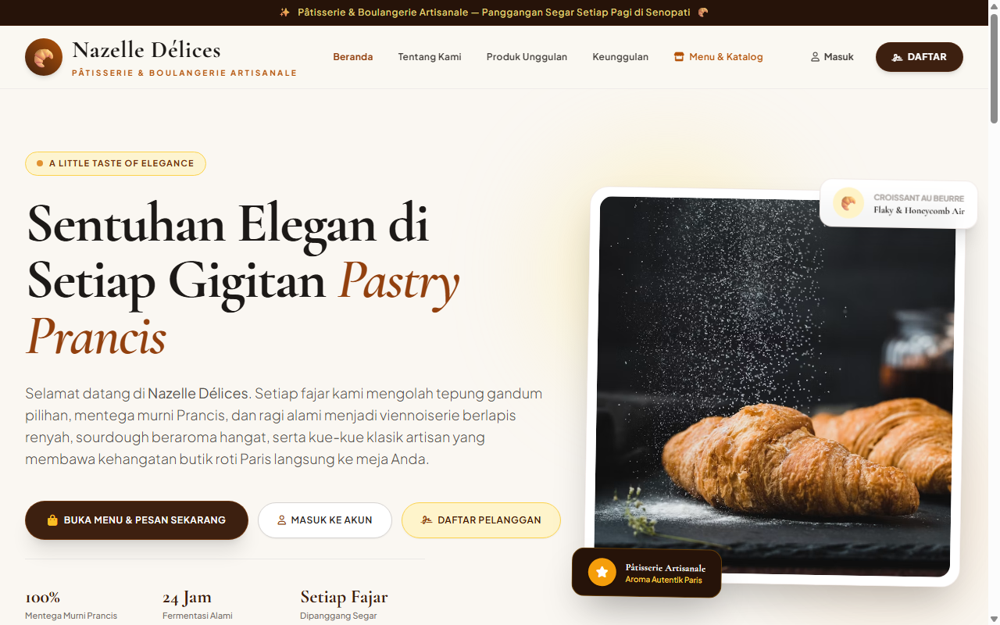
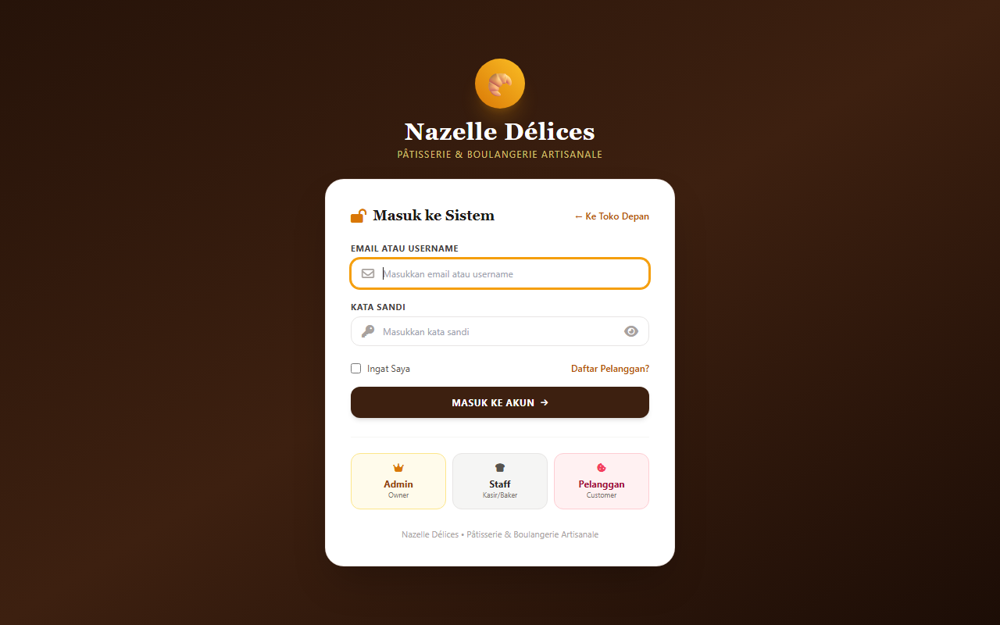
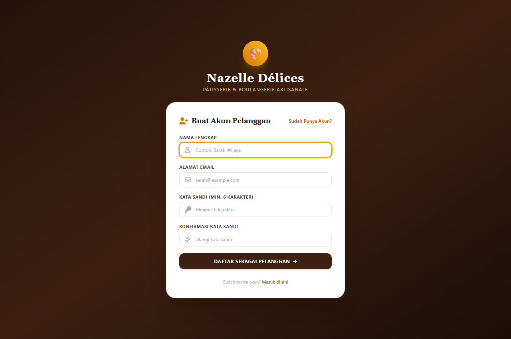
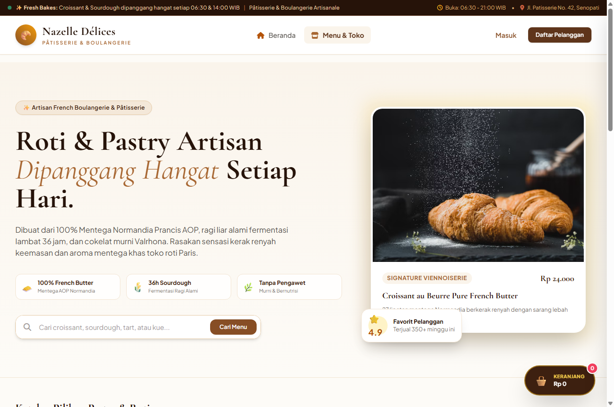
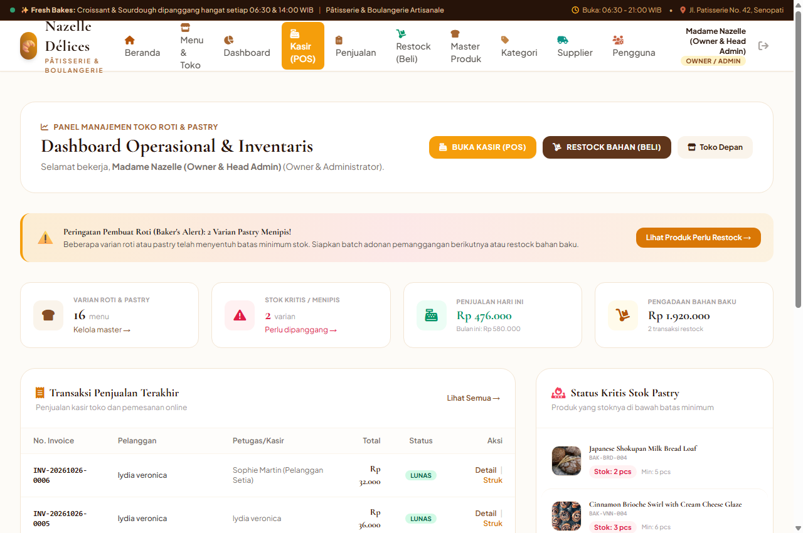
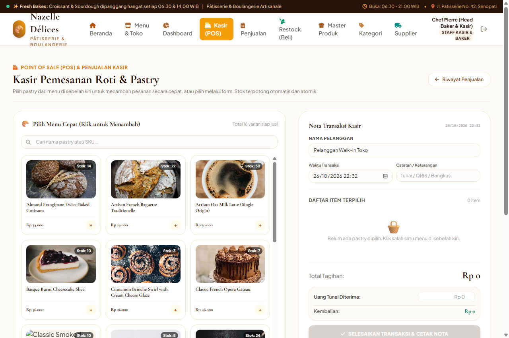
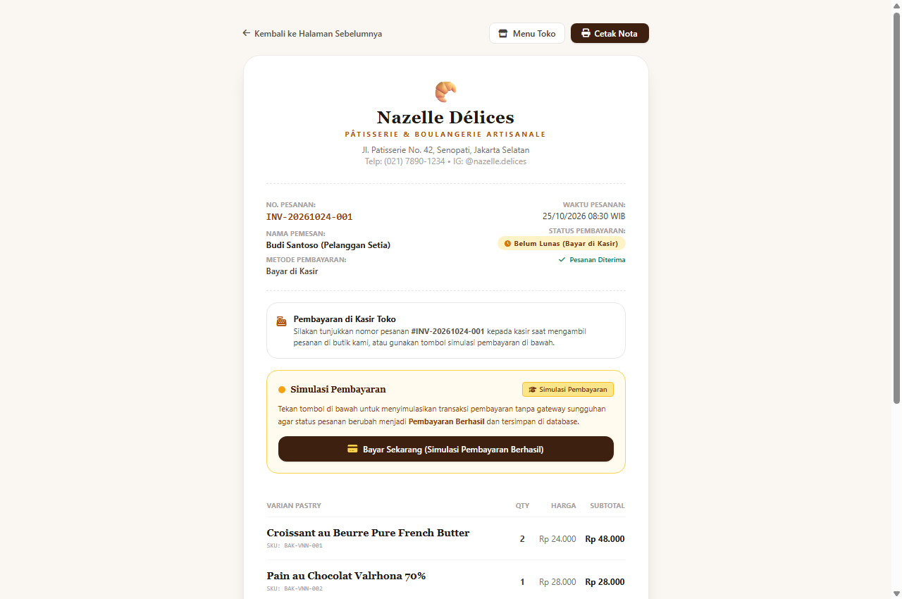
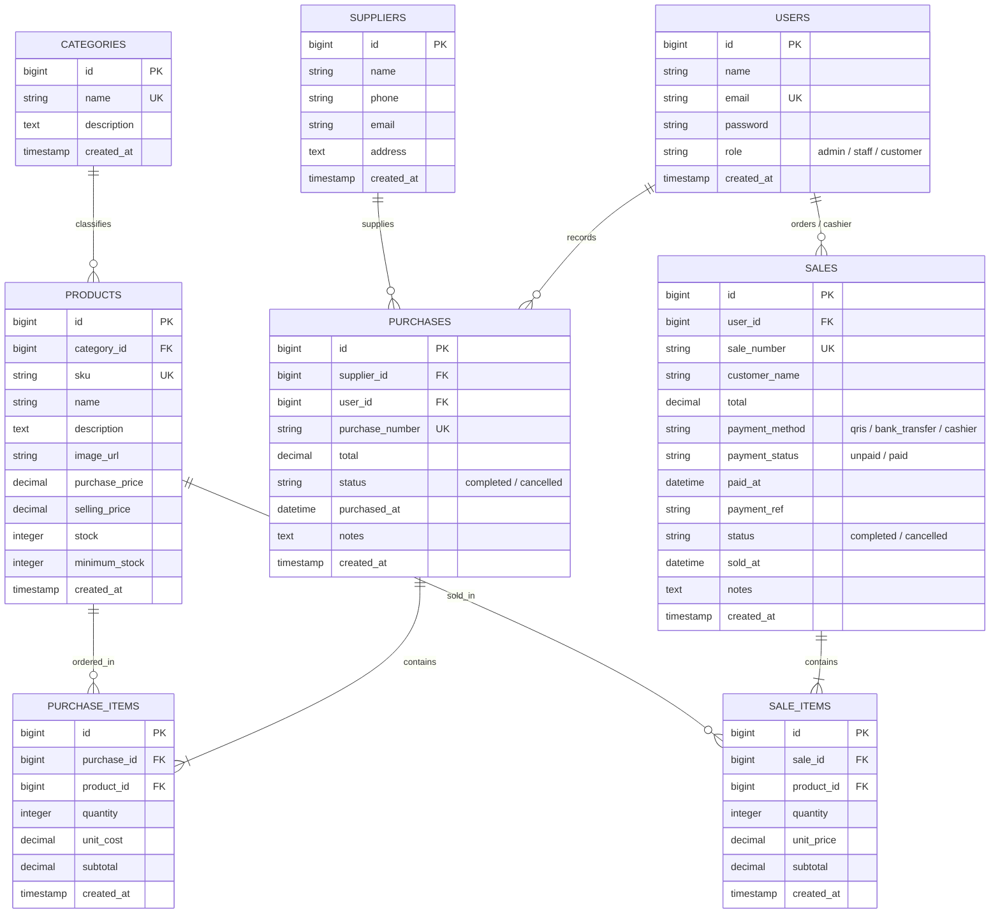

# Nazelle Délices — Artisan Bakery & Pastry Management System
> **"A Little Taste of Elegance"**  
> *Pâtisserie & Boulangerie Artisanale — Jakarta Selatan*  
> **Project Ujian Tengah Semester (UTS) — Pemrograman Web 2 (Laravel Framework)**

---

## 1. Tentang Project

**Nazelle Délices** adalah aplikasi web bisnis terintegrasi untuk butik roti dan *pastry* artisan Prancis yang berbasis di Senopati, Jakarta Selatan. Aplikasi ini dibangun secara komprehensif menggunakan **Laravel**, **Blade Templating**, **Tailwind CSS**, **Eloquent ORM**, dan mendukung koneksi database **SQLite** maupun **MySQL (XAMPP)**.

Sistem dirancang dengan arsitektur multi-peran (**Admin/Owner**, **Staff Kasir & Baker**, dan **Pelanggan**), menjamin keamanan transaksi atomik (*ACID*), pencegahan *overselling* stok (*pessimistic locking*), validasi harga *server-side* (*zero-trust client input*), serta antarmuka visual bertema *warm chocolate, cream & gold* yang elegan.

---

## 2. Fitur Utama & Galeri Tampilan Antarmuka Website

Berikut adalah dokumentasi fitur utama dan tangkapan layar (*screenshot*) setiap antarmuka website Nazelle Délices:

### 1. Halaman Beranda Publik (`/`)
Identitas brand elegan dengan tagline *"A Little Taste of Elegance"*, hero section interaktif, 3 pilar kualitas artisan Prancis (100% Mentega Prancis AOP, Fermentasi 36 Jam, Dipanggang Segar Setiap Pagi), etalase 6 kreasi pastry unggulan murni informatif, informasi butik Senopati, serta tombol navigasi Masuk & Daftar permanen.



---

### 2. Halaman Masuk / Login (`/login`)
Autentikasi akun aman berbasis database murni tanpa tombol bypass. Dilengkapi fitur interaktif **ikon mata (👁️)** untuk menampilkan/menyembunyikan kata sandi serta kartu informasi akun demo untuk kemudahan pengujian.



---

### 3. Halaman Pendaftaran Pelanggan (`/register`)
Formulir registrasi publik yang secara otomatis memvalidasi email unik, konfirmasi kata sandi minimal 6 karakter, dan secara tegas mengunci pendaftaran hanya untuk akun berstatus **Pelanggan (Customer)** demi mencegah eskalasi hak akses.



---

### 4. Etalase Katalog Toko & Pemesanan (`/katalog`)
Katalog menu pastry lengkap dengan filter kategori dinamis (*Viennoiserie, Sourdough, Patisserie, Cakes, Savory, Coffee*), pencarian instan (*live search*), indikator ketersediaan stok real-time, tombol pemesanan cepat, dan keranjang belanja interaktif (*slide-over cart drawer*) yang mendukung 3 metode pembayaran (**QRIS, Transfer Bank, Bayar di Kasir**).



---

### 5. Dashboard Eksekutif Owner / Admin (`/dashboard`)
Pusat pemantauan bisnis pemilik toko: menampilkan metrik total varian produk aktif, akumulasi omzet harian & bulanan, daftar peringatan stok kritis (*Baker's Alert*), serta akses manajemen master data (produk, kategori, supplier, pengguna, dan pembatalan transaksi).



---

### 6. Sistem Kasir POS Toko Roti (`/sales/create`)
Antarmuka kasir cepat untuk melayani pesanan fisik di butik Senopati. Kasir cukup mengklik kartu gambar menu, memasukkan nominal uang tunai yang diterima, dan kalkulator kasir akan otomatis menghitung kembalian uang pembeli.



---

### 7. Faktur Nota Transaksi & Simulasi Pembayaran (`/sales/{sale}/invoice`)
Bukti pemesanan resmi format struk belanja (*print-ready thermal receipt*). Dilengkapi tombol **Simulasi Pembayaran (Uji Coba UTS)** untuk menguji perubahan status transaksi menjadi *"Pembayaran Berhasil"* dengan tanggal/jam pelunasan dan nomor referensi unik terverifikasi di database.



---

## 3. Entity Relationship Diagram (ERD)



---

## 4. Panduan Menjalankan Project di VS Code (Windows)

Seluruh file project ini bersifat **mandiri (self-contained)** dalam satu folder.

### A. Persyaratan Sistem
* **Sistem Operasi**: Windows 10 / 11
* **Visual Studio Code**
* **PHP**: Versi 8.1 atau 8.2 (ekstensi `pdo_sqlite`, `pdo_mysql`, `mbstring`, `openssl`, `tokenizer`)
* **Composer** (opsional jika folder `vendor` sudah disertakan)
* **XAMPP / Laragon** (opsional jika menggunakan MySQL)

---

### B. Cara Tercepat (1-Klik via VS Code)
1. Buka **Visual Studio Code**.
2. Klik **File** -> **Open Folder...** -> Pilih folder project `Nazelle-Delices` (di `C:\Users\ASUS\Documents\Nazelle-Delices`).
3. Buka Terminal di VS Code (**Ctrl + `** atau menu **Terminal** -> **New Terminal**).
4. Jalankan script otomatis berikut:
   ```cmd
   .\jalankan.bat
   ```
5. Script akan secara otomatis:
   * Mendeteksi letak PHP di sistem atau XAMPP.
   * Menyiapkan file `.env` jika belum ada.
   * Menyiapkan database SQLite dan menjalankan migrasi/seeder jika belum ada.
   * Menjalankan server Laravel lokal di port 8000.
6. Buka browser dan akses alamat:
   👉 **`http://127.0.0.1:8000`**

---

### C. Cara Manual Step-by-Step

Jika Anda ingin menjalankan perintah satu per satu di Terminal VS Code:

#### 1. Salin Konfigurasi Environment
```bash
copy .env.example .env
```

#### 2. Pasang Dependency (jika folder vendor belum ada)
```bash
composer install
```

#### 3. Buat Kunci Aplikasi Laravel
```bash
php artisan key:generate
```

#### 4. Setup Database

##### Pilihan 1: Menggunakan SQLite (Paling Praktis, Tanpa Konfigurasi MySQL)
1. Pastikan di `.env` tertulis:
   ```env
   DB_CONNECTION=sqlite
   ```
2. Buat file database kosong (jika belum ada):
   ```cmd
   type nul > database\database.sqlite
   ```
3. Jalankan migrasi dan seeder:
   ```bash
   php artisan migrate:fresh --seed
   ```

##### Pilihan 2: Menggunakan MySQL (XAMPP)
1. Buka **XAMPP Control Panel**, lalu klik **Start** pada modul **Apache** dan **MySQL**.
2. Buka browser ke phpMyAdmin: `http://localhost/phpmyadmin`
3. Buat database baru bernama: `nazelle_delices`
4. Buka file `.env` di VS Code dan ubah bagian database menjadi:
   ```env
   DB_CONNECTION=mysql
   DB_HOST=127.0.0.1
   DB_PORT=3306
   DB_DATABASE=nazelle_delices
   DB_USERNAME=root
   DB_PASSWORD=
   ```
5. Jalankan migrasi dan seeder di terminal:
   ```bash
   php artisan migrate:fresh --seed
   ```

#### 5. Jalankan Server Pengembangan
```bash
php artisan serve
```
Akses di browser: **`http://127.0.0.1:8000`**

---

## 5. Kredensial Akun Demo (Hasil Seeder)

Semua akun bawaan menggunakan kata sandi: **`password`**

| Role / Peran | Nama Pengguna | Email Login | Kata Sandi | Hak Akses & Fitur |
| :--- | :--- | :--- | :--- | :--- |
| 👑 **Admin (Owner)** | Madame Nazelle | `admin@nazelle.test` | `password` | Manajemen user, CRUD produk, kategori, supplier, restock bahan, POS kasir, pembatalan penjualan, dashboard eksekutif. |
| 🥖 **Staff (Kasir/Baker)** | Chef Pierre | `staff@nazelle.test` | `password` | Dashboard kasir, POS penjualan langsung, restock bahan masuk dari supplier, katalog produk. |
| 🧁 **Pelanggan (Customer)** | Sophie Martin | `pelanggan@nazelle.test` | `password` | Katalog menu toko, keranjang belanja, checkout QRIS/Transfer/Kasir, simulasi pembayaran, cetak invoice nota belanja. |

*(Anda juga dapat mendaftarkan akun pelanggan baru secara langsung melalui halaman registrasi di `/register`).*

---

## 6. Panduan Upload Project ke GitHub

Ikuti langkah-langkah berikut untuk meng-upload project ke akun GitHub Anda:

### Langkah 1: Buat Repository Baru di GitHub
1. Masuk ke akun GitHub Anda di browser: [https://github.com/new](https://github.com/new)
2. Masukkan **Repository name**, misalnya: `nazelle-delices-uts`
3. Pilih visibilitas: **Public** atau **Private**.
4. **PENTING**: Biarkan bagian *"Initialize this repository with a README, .gitignore, or license"* **KOSONG / TIDAK DICENTANG** (karena project ini sudah memiliki file `.gitignore` dan `README.md` sendiri).
5. Klik tombol **Create repository**.

### Langkah 2: Inisialisasi dan Push dari Terminal VS Code
Buka terminal VS Code di folder project ini, lalu jalankan perintah berikut secara berurutan:

```bash
# 1. Inisialisasi git pada folder project
git init

# 2. Tambahkan semua file project ke staging area
git add .

# 3. Buat commit pertama
git commit -m "feat: complete Nazelle Delices Laravel bakery management project"

# 4. Ubah nama branch utama menjadi main
git branch -M main

# 5. Hubungkan ke repository GitHub Anda (ganti URL di bawah dengan URL repo Anda)
git remote add origin https://github.com/USERNAME-ANDA/nazelle-delices-uts.git

# 6. Upload seluruh file ke GitHub
git push -u origin main
```

> **Keamanan Terjamin**:
> File `.gitignore` pada project ini telah dikonfigurasi untuk secara otomatis mengecualikan:
> - File kredensial sensitif: `.env`, `.env.backup`, `.env.production`
> - Folder library: `/vendor`, `/node_modules`
> - File database lokal: `database/*.sqlite`
> - Cache dan log sistem: `storage/logs/*.log`, `.phpunit.result.cache`
>
> File `.env.example` disertakan secara aman sebagai template konfigurasi bagi siapa pun yang meng-clone repository ini.

---

## 7. Hasil Pengujian Otomatis (24 Test Cases - 100% Passed)

Seluruh 24 skenario pengujian fitur dan unit (*feature & unit tests*) pada file [`tests/Feature/InventoryAndSalesTest.php`](tests/Feature/InventoryAndSalesTest.php) berhasil lolos tanpa kendala:

```
PASS  Tests\Unit\ExampleTest
✓ that true is true

PASS  Tests\Feature\ExampleTest
✓ the application returns a successful response

PASS  Tests\Feature\InventoryAndSalesTest
✓ guest cannot access dashboard and is redirected to login
✓ user cannot login with invalid credentials
✓ demo bypass route is removed
✓ user can login with valid credentials
✓ product creation rejects duplicate sku and negative price
✓ purchase transaction successfully increments stock
✓ sale transaction successfully decrements stock and calculates server total
✓ sale transaction fails when stock is insufficient and rolls back data
✓ atomicity transaction rollback when one item fails
✓ staff cannot access admin user management routes
✓ admin can cancel sale and restore stock
✓ product cannot be deleted if used in transactions
✓ customer can login and access catalog but cannot access admin or purchases
✓ customer can checkout from storefront cart and atomically decrement stock
✓ customer checkout fails if pastry stock is insufficient
✓ guest can register as customer
✓ customer can checkout without phone and with payment method
✓ guest can checkout and view invoice without login
✓ payment simulation via invoice updates database and displays receipt
✓ checkout with instant simulation creates paid transaction immediately
✓ landing page is accessible to guests and displays brand and tagline
✓ landing page displays masuk and daftar even when logged in

Tests:  24 passed (63 assertions)
Time:   1.75s
```

Untuk menjalankan ulang pengujian di terminal VS Code:
```bash
php artisan test
```

---

## 8. Panduan Menjawab Pertanyaan Code Ownership UTS (Bahan Presentasi)

Berikut adalah ringkasan teknis untuk menjawab pertanyaan penguji/dosen:

1. **Mengapa model `Sale` memiliki relasi `hasMany` ke `SaleItem`?**
   > Transaksi penjualan di dunia nyata bersifat multi-item: satu nomor nota (`Sale`) dapat memuat beberapa varian pastry yang berbeda dengan jumlah masing-masing (`SaleItem`). Foreign key `sale_id` ditempatkan pada tabel `sale_items` untuk memenuhi normalisasi database (1NF & 2NF) sehingga data tidak redundan.

2. **Di mana dan bagaimana sistem memastikan stok tidak pernah negatif saat dibeli bersamaan?**
   > Pada [`app/Http/Controllers/SaleController.php`](app/Http/Controllers/SaleController.php) dan [`app/Http/Controllers/StorefrontController.php`](app/Http/Controllers/StorefrontController.php). Sistem menggunakan *pessimistic locking* (`Product::lockForUpdate()->findOrFail($id)`) di dalam blok `DB::transaction()`. Jika stok produk kurang dari jumlah yang diminta (`$product->stock < $qty`), server langsung melempar `ValidationException` dan seketika membatalkan (*rollback*) seluruh mutasi database.

3. **Mengapa total belanja pelanggan dihitung di server, bukan di browser (JavaScript)?**
   > Mengikuti prinsip *Zero-Trust Client Input*. Nilai harga pada HTML/JavaScript dapat dimodifikasi oleh pengguna melalui browser DevTools atau request manipulasi via Postman. Oleh karena itu, server mengambil harga satuan resmi langsung dari database (`$product->selling_price`) dan menghitung subtotal serta total pembayaran secara independen.

4. **Apa risiko jika pemotongan stok dilakukan di luar `DB::transaction`?**
   > Terjadinya inkonsistensi data (*dirty data*): jika record penjualan berhasil tersimpan tetapi terjadi *crash*, server down, atau putus koneksi sebelum baris pemotongan stok dieksekusi, stok di toko tidak akan pernah berkurang padahal barang telah terjual. Dengan `DB::transaction`, seluruh proses bersifat *atomic* (*all-or-nothing*).

5. **Bagaimana mencegah Staff atau Pelanggan mengakses URL menu Admin secara langsung?**
   > Melalui proteksi server-side menggunakan middleware `EnsureAdmin` ([`app/Http/Middleware/EnsureAdmin.php`](app/Http/Middleware/EnsureAdmin.php)). Jika pengguna yang sedang login tidak memiliki role `admin`, server langsung memutus request dan mengembalikan HTTP status `403 Forbidden`.

6. **Apa fungsi constraint database unik pada SKU produk?**
   > Constraint `$table->string('sku', 50)->unique()` pada migration bertindak sebagai benteng pertahanan terakhir (*data integrity guarantee*) di level database engine (MySQL/SQLite) untuk menjamin tidak akan pernah ada dua produk dengan kode SKU yang sama meskipun terjadi eksekusi *concurrent* secara simultan.

---

## 9. Struktur Folder Utama Project

```
Nazelle-Delices/
├── app/
│   ├── Http/
│   │   ├── Controllers/       # Controller: Landing, Storefront, Auth, Sale, Product, dll.
│   │   └── Middleware/        # Middleware: EnsureAdmin, EnsureStaff, Authenticate
│   └── Models/                # Eloquent Models: User, Product, Category, Sale, Purchase, Supplier
├── config/                    # Konfigurasi aplikasi, database, dan session
├── database/
│   ├── factories/             # Data dummy factories untuk pengujian
│   ├── migrations/            # 13 file migrasi tabel terstruktur
│   ├── seeders/               # DatabaseSeeder dengan data pastry & pengguna awal
│   └── database.sqlite        # Database lokal SQLite siap pakai
├── public/                    # Web root (index.php, aset favicon, dll.)
├── resources/
│   └── views/
│       ├── auth/              # Form login (dengan ikon mata 👁️) & register
│       ├── dashboard/         # Dashboard interaktif untuk 3 role
│       ├── landing/           # Landing page publik Nazelle Délices
│       ├── layouts/           # Template master app bertema bakery & navigasi
│       ├── products/          # Manajemen master produk
│       ├── sales/             # POS kasir, riwayat penjualan, & faktur nota belanja
│       ├── purchases/         # Manajemen restock bahan baku supplier
│       └── storefront/        # Etalase katalog & keranjang belanja online
├── routes/
│   └── web.php                # 56 route web terorganisir rapi
├── storage/                   # File log, cache, dan session
├── tests/
│   └── Feature/               # InventoryAndSalesTest.php (24 skenario pengujian)
├── .env                       # File konfigurasi environment aktif (lokal)
├── .env.example               # Template environment aman untuk GitHub
├── .gitignore                 # Konfigurasi pengecualian file sensitif Git
├── composer.json              # Daftar pustaka dependensi PHP
├── jalankan.bat               # Script otomatis 1-klik untuk menjalankan di Windows
├── PANDUAN_MENJALANKAN_DI_VSCODE.txt # Panduan cepat teks untuk pengguna VS Code
└── README.md                  # Dokumentasi lengkap project
```

---

*Nazelle Délices — Artisan Bakery & Pastry Management System &copy; 2026. All rights reserved.*
